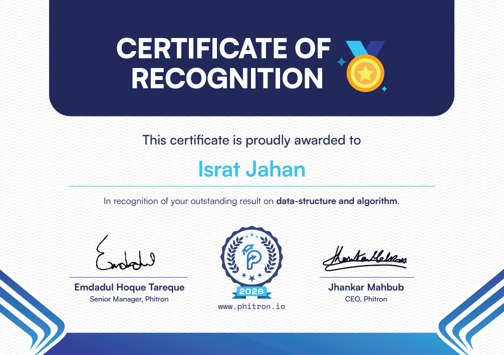

# 👋 Hi there, I'm Israt Jahan

  <b>⚡ <i>"From stack to intelligence: engineering smarter software."</i></b>

---

## 👨‍💻 About Me

I am an **AI-Driven Software Engineer & Full-Stack Developer** with a **BSc in Computer Science and Engineering** from Port City International University (Graduated with **First Class Honours**, CGPA **3.76 / 4.00**). 

I specialize in architecting scalable, performant, and secure end-to-end web products using **Next.js, TypeScript, Node.js, and PostgreSQL**, coupled with a deep interest in **Data Structures, Algorithms, and NLP/Machine Learning research**.

- 🔭 **Currently Building:** [Delivexaa](https://github.com/erab2r) — a modern courier & logistics platform (Node.js, Express, TypeScript, Prisma, PostgreSQL).
- 🧠 **Research & AI:** Published **2 IEEE peer-reviewed papers** on Bengali NLP, Transformer architectures, and hybrid deep learning models.
- 💡 **Core Strengths:** Full-Stack Architecture, RESTful API Design, Relational Database Modeling, JWT Authentication & RBAC, Payment Gateway Integration (Stripe, bKash, SSLCommerz).
- 🎯 **Competitive Programming:** Active problem solver on LeetCode, Codeforces, and CodeChef.
- 📫 **Get in Touch:** [shkera213@gmail.com](mailto:shkera213@gmail.com)

---

## 🧩 Problem Solving & Competitive Programming

---

## 🏆 Achievements & Certifications

### 📜 Certificate of Recognition — Data Structures & Algorithms
> Recognized by **Phitron** for outstanding academic performance and problem-solving excellence in **Data Structures and Algorithms**.

  
  
<i>Phitron · 2026 · Outstanding Result in Data Structure and Algorithm</i>

### 🎓 Academic & Research Highlights
- 🥇 **First Class Honours (CGPA: 3.76 / 4.00)** — BSc in Computer Science and Engineering, Port City International University.
- 📚 **IEEE Published Researcher**:
  - **[Bengali Hate Speech Categorization: A Comparison of Hybrid Deep Learning and Transformer-Based Models](https://ieeexplore.ieee.org/document/10955953/authors#authors)** *(IEEE Xplore)*
  - **[Depression Detection from Bangla Text Using BanglaBERT and Hybrid Deep Learning Techniques](https://ieeexplore.ieee.org/document/11013401)** *(IEEE Xplore)*

---

## 💻 Tech Stack

### 🎨 Frontend Development

### ⚙️ Backend & API Development

### 🗄️ Database & ORM

### 🤖 AI, Machine Learning & NLP

### 🛠️ Tools & DevOps

---

## 🚀 Featured Projects

| Project | Description | Stack | Links |
| :--- | :--- | :--- | :---: |
| **🚚 Delivexaa** | Enterprise courier and logistics tracking system with role-based dashboards, secure dispatch flows, and parcel management. | Node.js, Express, TypeScript, Prisma, PostgreSQL | [Code](https://github.com/erab2r) |
| **⚖️ Justice Desk** | Full-stack lawyer consultation platform with appointment booking, legal case management, and payment processing. | Next.js, TypeScript, Node.js, Express, Prisma, PostgreSQL | [Live](https://portfolio-two-sand-9di0sr60nj.vercel.app/) · [Code](https://github.com/erab2r) |
| **🔧 Fix It Now** | Home service booking platform connecting customers with vetted technicians, complete with online payments and multi-tier auth. | Express.js, TypeScript, Prisma, PostgreSQL, JWT | [Live](https://portfolio-two-sand-9di0sr60nj.vercel.app/) · [Code](https://github.com/erab2r) |

---

## 📊 GitHub Analytics

<table>
  <tr>
    <td align="center" width="50%">
      
    </td>
    <td align="center" width="50%">
      
    </td>
  </tr>
  <tr>
    <td colspan="2" align="center">
      
    </td>
  </tr>
</table>

---

## 📬 Let's Connect!

I am always open to discussing new opportunities, collaborations, and software engineering projects.

 

⭐️ *If you find my projects helpful or interesting, feel free to give them a star!* ⭐️

---

## 📬 Let's Connect!

I am always open to discussing new opportunities, collaborations, and software engineering projects.

 

⭐️ *If you find my projects helpful or interesting, feel free to give them a star!* ⭐️

